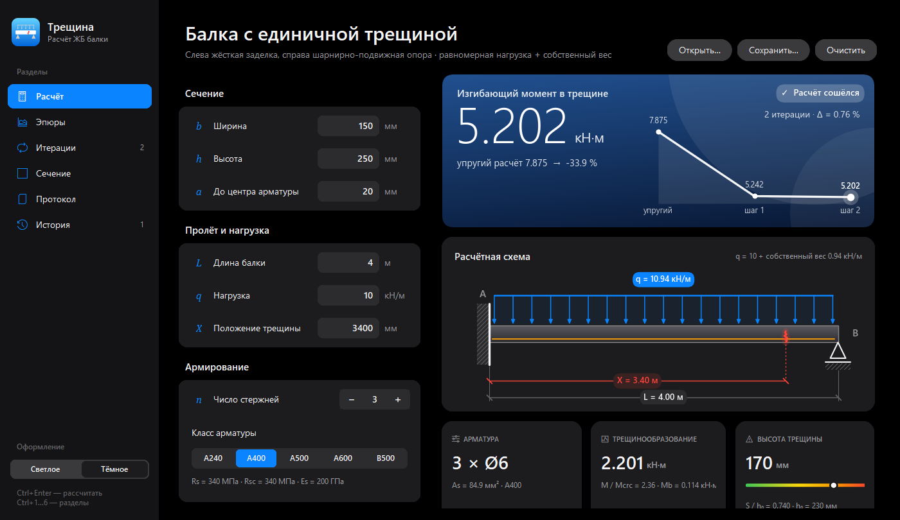
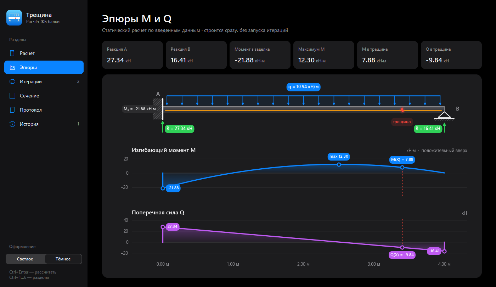
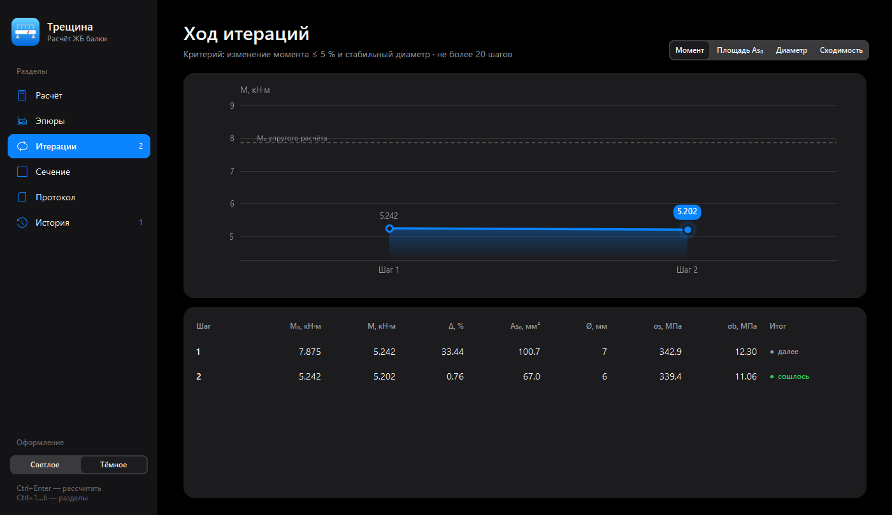
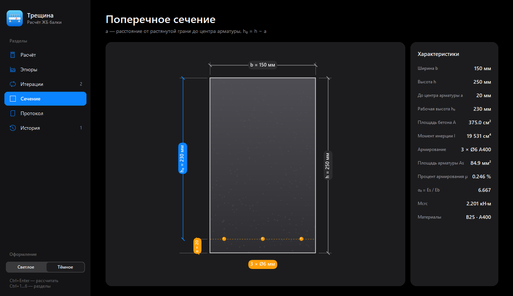
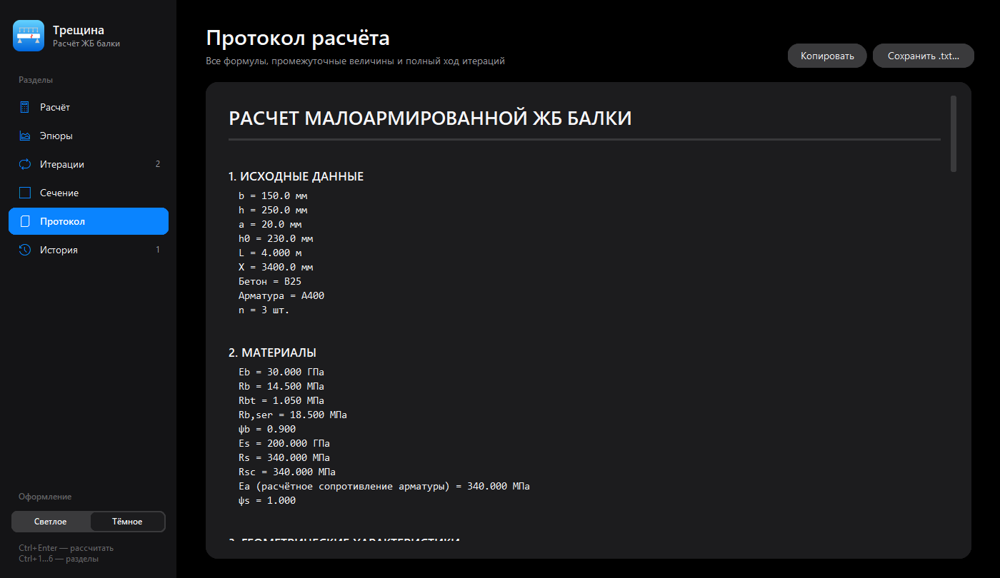

# Трещина — расчёт балки с единичной трещиной

Программа для расчёта **малоармированной статически неопределимой железобетонной балки с единичной трещиной** методами механики разрушения. Трещина учитывается по блочной модели Е.Н. Пересыпкина, усилия в сечении с трещиной находятся итерационно из системы канонических уравнений.



## Что умеет

- **Ввод по СП 63.13330:** бетон B15–B60, арматура A240, A400, A500, A600, B500, геометрия сечения, пролёт, нагрузка и положение трещины.
- **Живая расчётная схема:** балка, нагрузка и трещина перерисовываются прямо во время ввода.
- **Эпюры M и Q** с реакциями опор и значениями в характерных точках.
- **Итерационный расчёт** до сходимости: изменение момента не больше 5 % при стабильном подобранном диаметре арматуры.
- **Параметры трещины** по графикам Пересыпкина: глубина S/h₀, коэффициенты K и ξ₁, момент трещинообразования Mcrc, напряжения σs и σb.
- **Подбор арматуры** по сортаменту на каждой итерации.
- **Полный протокол:** все формулы и промежуточные значения каждой итерации; можно скопировать или сохранить в .txt.
- **Проекты и история:** сохранение и открытие исходных данных в JSON, журнал последних расчётов.
- **Светлая и тёмная темы.**

| Эпюры | Итерации |
|---|---|
|  |  |
| **Сечение** | **Протокол** |
|  |  |

## Расчётная схема

Один пролёт: слева жёсткая заделка, справа шарнирно-подвижная опора. Нагрузка равномерная — собственный вес плюс заданная. Трещина задаётся координатой X от заделки.

## Алгоритм

1. **Упругий расчёт:** M₀ и Q₀ в сечении трещины.
2. **Сечение:** подбор As по требуемой As₀, момент трещинообразования Mcrc.
3. **Графики Пересыпкина:** по параметру L = 1,7·b·h₀^1,5 / M₀ и приведённому армированию α₀m определяются S/h₀, K и ξ₁; Mb = K·Mcrc.
4. **Напряжения и податливость:** σs, σb и поправка податливости сечения δM*.
5. **Канонические уравнения:**
   (δMM + δM*)·M + δMQ·Q + ΔMP = 0;  δQM·M + δQQ·Q + ΔQP = 0.
6. Если |M₀ − M| / M₀ > 5 % или меняется диаметр арматуры, M и Q становятся новыми M₀ и Q₀, и шаги повторяются.

Графики Пересыпкина оцифрованы вручную; между узлами используется линейная интерполяция. Экстраполяция за пределы кривых не выполняется: если данные выходят из диапазона, программа останавливает расчёт и сообщает об этом.

## Пример

Балка 150 × 250 мм, a = 20 мм, L = 4 м, q = 10 кН/м, X = 3,4 м, бетон B25, арматура A400, n = 3 — это значения по умолчанию.

| | M, кН·м | Δ, % | Ø, мм | S/h₀ |
|---|---|---|---|---|
| Упругий расчёт | 7,875 | — | — | — |
| Итерация 1 | 5,242 | 33,44 | 7 | 0,788 |
| Итерация 2 | 5,202 | 0,76 | 6 | 0,740 |

Итог: момент в сечении с трещиной на 34 % меньше упругого; принято 3 × Ø6 A400.

## Запуск

Нужен Python 3.10 или новее.

```bash
pip install -r requirements.txt
python crack_beam.py
```

Горячие клавиши: Ctrl+Enter — рассчитать, Ctrl+S — сохранить проект, Ctrl+O — открыть, Ctrl+1…6 — разделы.

## Ограничения

- Одна трещина и однопролётная схема.
- Диапазон приведённого армирования ограничен оцифрованными кривыми: α₀m = 0,013…0,038.
- Длительная нагрузка и ползучесть бетона не учитываются.

## Источник методики

Зайцев Ю.В., Окольникова Г.Э., Доркин В.В. Механика разрушения для строителей: учебное пособие. 2-е изд. — М.: ИНФРА-М, 2020. Глава 8 «Механика разрушения железобетона».
